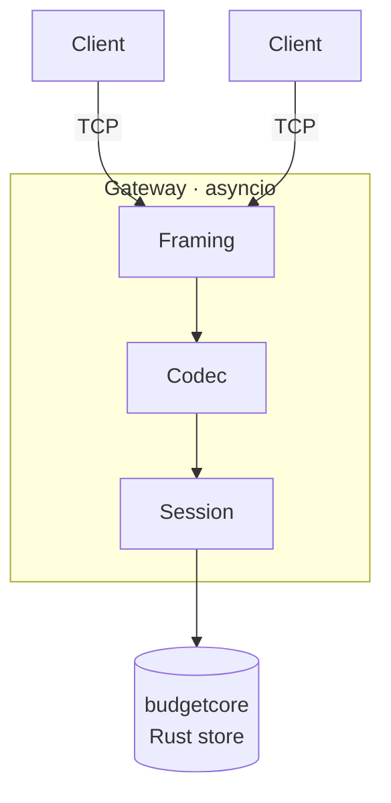

# budgetgate

[](https://github.com/andypaling/budgetgate/actions/workflows/ci.yml)
[](LICENSE)
[](https://doc.rust-lang.org/edition-guide/rust-2024/)

A limits gateway with a Rust core. Reserve against a budget, then commit
or release; concurrent reserves never exceed the limit.

## Quickstart

```python
import asyncio

from budgetgate import BudgetExceeded, Store
from budgetgate.client import Client
from budgetgate.gateway import Gateway


async def main() -> None:
    async with Gateway(Store(), port=7878), await Client.connect(port=7878) as client:
        await client.set_limit("acct-1", 1_000)  # minor units, e.g. pence
        rid = await client.reserve("acct-1", 400)  # hold 400 against the limit
        await client.commit(rid, 350)  # settle for 350; 50 freed
        print(await client.view("acct-1"))
        # BudgetView(limit=1000, used=350, committed=350, reserved=0)

        try:
            await client.reserve("acct-1", 700)
        except BudgetExceeded as e:
            print(e)  # budget exceeded: requested: 700, available: 650


asyncio.run(main())
```

## Architecture


## Protocol

Custom RPC over TCP: a 4-byte preamble (BG, wire version, format byte), then length-prefixed frames (4-byte big-endian length, max 64 KiB). Payloads are JSON today. the codec is pluggable.

Length prefix selected to allow future support for binary codecs.

## Roadmap

- Multi-process race tests
- Basic CLI
- Protobuf codec
- Load testing
- Pipelined client
